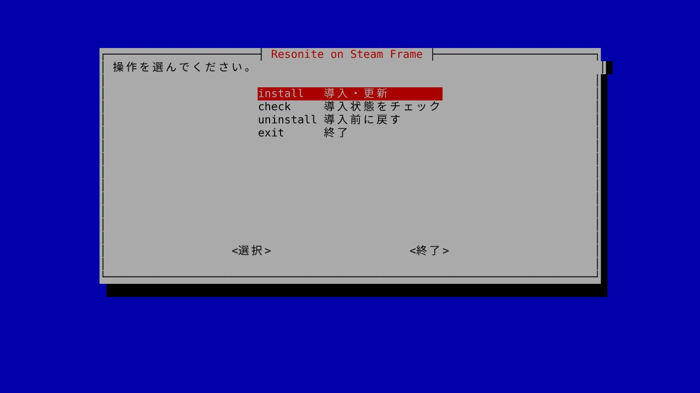

# Resonite on Steam Frame

Steam FrameでSteam版Resoniteを動かすための非公式セットアップです。起動、音声入出力、FBXモデルのインポート、動画URLの読み込み、画像変換に必要な設定と実行環境をまとめて導入します。

SteamOS 0.5.8、Resonite `2026.11.11.21`（Steam build `26579448`）で動作を確認しています。

## クイックスタート

Steam FrameにSteam版ResoniteとProton Experimentalをインストールしてください。Resoniteを終了し、Frameのターミナルで実行します。

```bash
curl -fsSL https://raw.githubusercontent.com/kazu0617/resonite-steam-frame/main/install.sh -o install-resonite-frame.sh && bash install-resonite-frame.sh
```

初回はそのまま導入が始まります。数分で完了したら、SteamからResoniteを起動してください。必要な.NETは、Resoniteの要求に合わせて自動で選びます。

2回目以降は以下の画面が表示されます。



## コマンドで直接操作する

メニューを開かずに操作することもできます。チェックはResoniteの起動中でも実行できます。

```bash
bash install-resonite-frame.sh --install    # 導入・更新
bash install-resonite-frame.sh --check      # チェック
bash install-resonite-frame.sh --uninstall  # 導入前に戻す
```

復元するときはResoniteを終了し、Steamの起動・終了状態を導入時とそろえてください。

## ライセンス・外部ソース

- 本ツールのコードは[MIT License](LICENSE)です。
- Resonite、Microsoft .NET、各ネイティブライブラリには、それぞれのライセンスが適用されます。
- [Microsoft .NET](https://dotnet.microsoft.com/)：Resoniteエンジンの実行環境
- [mikktspace](https://github.com/Yellow-Dog-Man/Mikktspace.NET)：FBXモデルのインポートに使用
- [Compressonator](https://github.com/Yellow-Dog-Man/compressonator)：画像の圧縮・変換に使用
- [yt-dlp](https://github.com/yt-dlp/yt-dlp)と[Deno](https://github.com/denoland/deno)：動画URLの読み込みに使用
